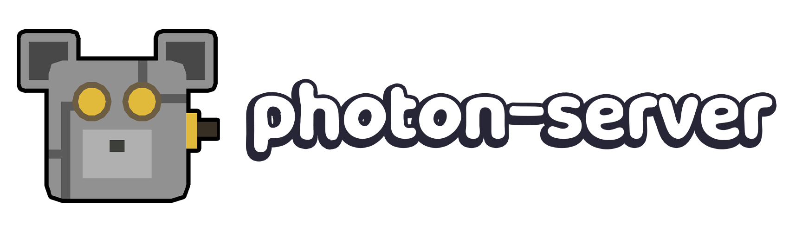

<div align="center">
  
</div>

# photon-server

A self-hosted server alternative to Photon Cloud, designed for private servers compatible with PUN2 (UDP) clients.

> **Why is the logo a robot bear?** In the interest of transparency: this project was originally built to host private servers for the game *Super Bear Adventure*, which is where the robot-bear logo comes from. The server itself is game-agnostic — see [Scope & Current Goals](#scope--current-goals).

## Overview

This project implements a server that speaks the Photon networking protocol, allowing PUN2 UDP clients to connect to a privately hosted server instead of Photon Cloud. It targets the common subset of the protocol used by PUN2 games over UDP.

## Scope & Current Goals

The project is intentionally narrow. It is **not** a drop-in Photon Cloud clone.

### Relay mode only

The server currently implements **relay-mode multiplayer only** — i.e. the LoadBalancing/room model where the server:

- handles connect / encryption handshake / authentication,
- manages lobbies, rooms, matchmaking (create / join / rejoin) and the master-client / game-server redirect,
- tracks actors, room properties and player properties,
- **relays** events, RPCs, instantiates and serialization updates between the clients in a room, and
- replays cached events to late joiners.

It is a **relay**: the clients are the authority and the server forwards their traffic. There is no server-side game logic, no authoritative simulation.

### Supported serialization protocols

Photon clients serialize their payloads with one of two on-the-wire formats. The server auto-detects which one a peer uses (from the first parameter-bearing message) and handles both:

- **GpBinaryV16** (`Protocol16`)
- **GpBinaryV18** (`Protocol18`) — the format modern PUN2 builds use

Other/older serialization protocols are not supported. If a client negotiates something else, it won't work.

### Not in scope

Non-relay networking is explicitly out of scope (see below). Things like server-authoritative game logic, custom server plugins, WebRPC/webhooks, external custom authentication providers, and MMO-style interest management are **not** planned.

## Requesting support for a game

Support is added per protocol version, not per game — but knowing which game you're trying to run helps us prioritize which protocol versions and behaviors to cover. If a game doesn't work, open an issue using the format below.

**Title:**

```
GAME REQUEST: [game title]
```

**Body:**

```
Game Name: [Game Name]
Game BundleId (if applicable): [bundle id]
game version: [game version]
photon version (if known): [photon version]
game engine: [game engine]

[explain why you want support for it]
```

### What we will implement

- **Protocol versions / serialization formats.** If a requested game relies on a Photon serialization or protocol version we don't yet handle, that's a valid request and the kind of thing we'll work to support.

### What we will NOT implement

- **Non-relay networking.** Anything beyond relaying client traffic — server-authoritative game logic, custom server-side plugins, WebRPC, external auth backends, etc. — is out of scope and won't be implemented, regardless of the game.

## How It Was Built

The protocol implementation is based entirely on observational work:

- **Reverse engineering** — games that use Photon were analyzed to understand message structure, operation codes, and handshake behavior.
- **Packet sniffing** — network traffic between PUN2 clients and Photon Cloud was captured and inspected to document the wire protocol.

No Photon SDK source code was read, referenced, or used at any point in the development of this project. The implementation was derived purely from observed behavior and captured network data.

## Disclaimer

This project is not affiliated with, endorsed by, or connected to Exit Games in any way. Photon is a trademark of Exit Games GmbH.

This project does not ship any Photon SDK or Exit Games code. It is intended for private, non-commercial use only. You should not use this project for commercial purposes.
